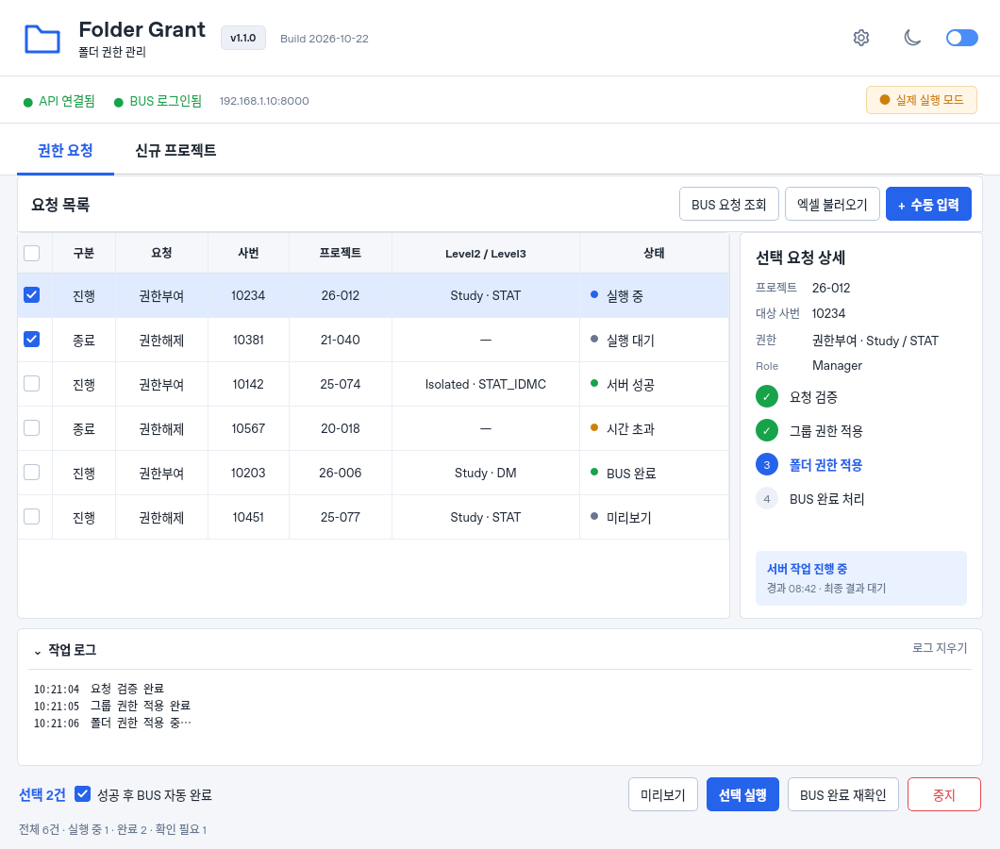
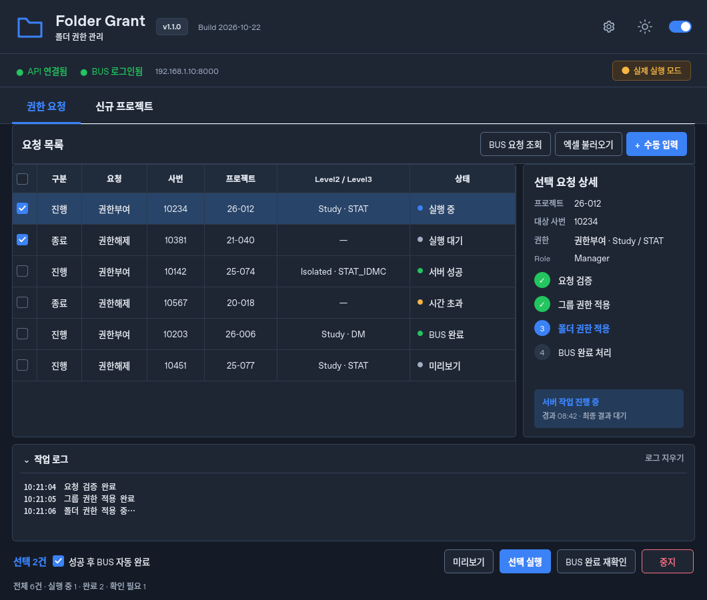

# Client v1.1.0 실제 화면

아래 이미지는 생성형 디자인 이미지가 아니라 **변경된 PyQt 프로그램을 실행하여 캡처한 화면**입니다. 화면 비교용 샘플 데이터이며 실제 API·BUS·AD·폴더 권한 작업을 호출하지 않습니다.

| 라이트 | 다크 |
|---|---|
| [](client-light-v1.1.0.png) | [](client-dark-v1.1.0.png) |

[신규 프로젝트 탭](client-projects-v1.1.0.png)

[사용자가 승인한 원래 시안](https://github.com/Corggi-Kim/Folder-Grant-Tool/blob/codex/client-ui-preview-2026-10-22/docs/mockups/client-ui-light-dark.png)

기준 크기는 1060×900이며 운영체제의 창 제목 표시줄은 캡처 대상에서 제외됩니다. Windows의 기본 글꼴과 DPI 설정에 따라 글자 너비와 제목 표시줄은 달라질 수 있습니다. 배치·색상·열 비율·동작은 같은 프로그램 코드로 유지합니다.

## 재현

저장소 루트에서 클라이언트 의존성이 설치된 Python으로 실행합니다.

```powershell
python Client/tests/render_ui_preview.py --projects
```

Linux에서는 `QT_QPA_PLATFORM=offscreen`을 지정할 수 있습니다. 테스트 픽스처로 네트워크 동작을 대체하고 샘플 상태를 주입한 뒤, 실제 `AccessManager` 위젯의 `grab()` 결과를 PNG로 저장합니다. 제품 실행에는 이 샘플 데이터를 넣지 않습니다.
